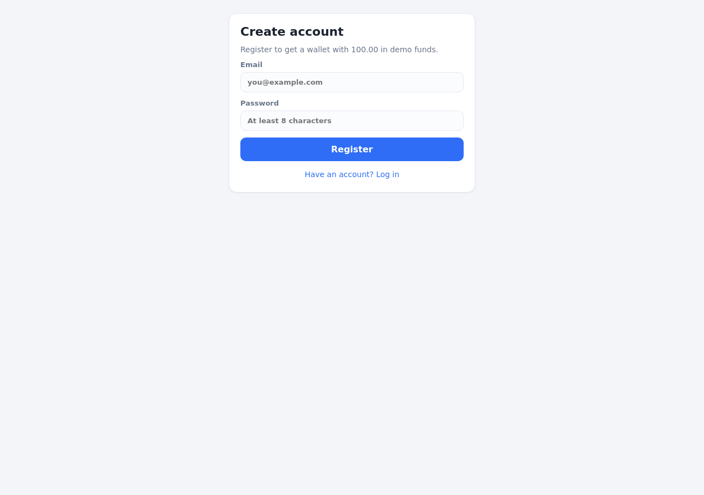
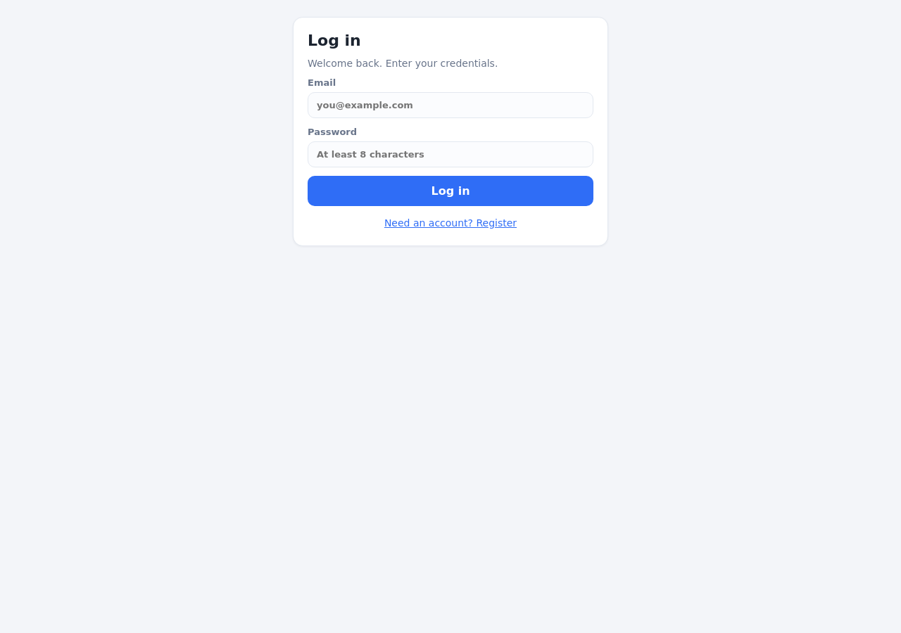
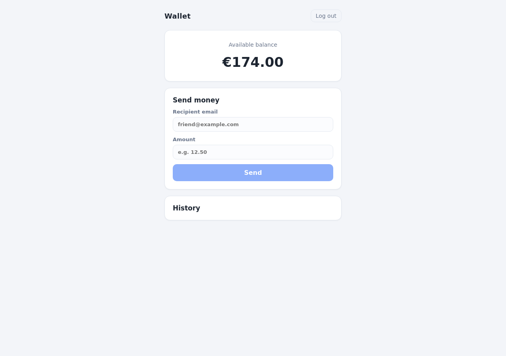
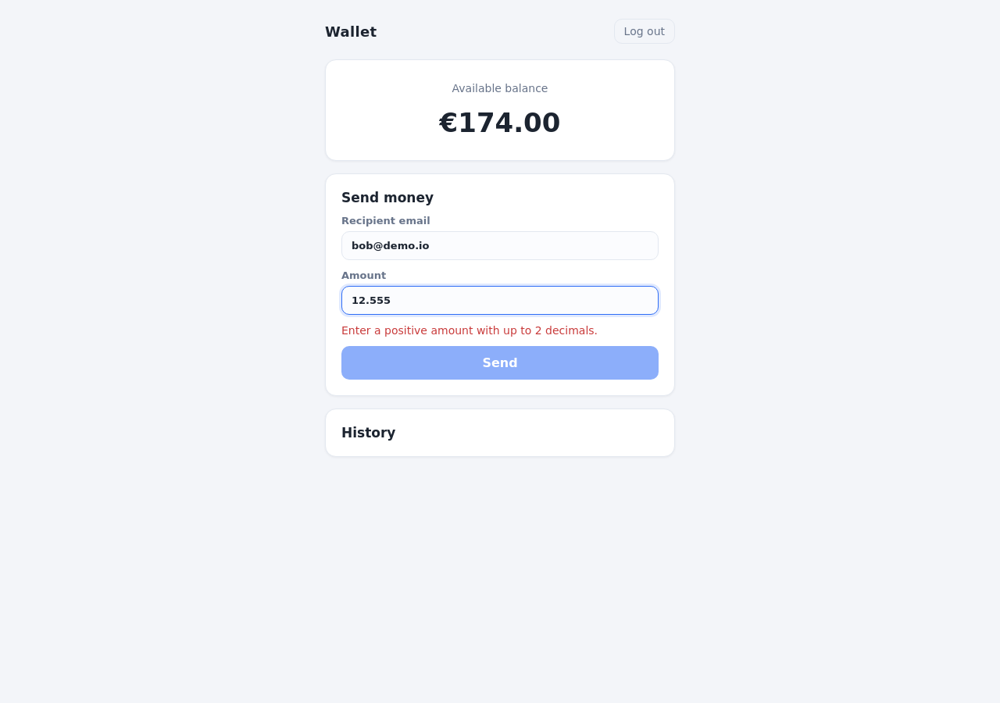
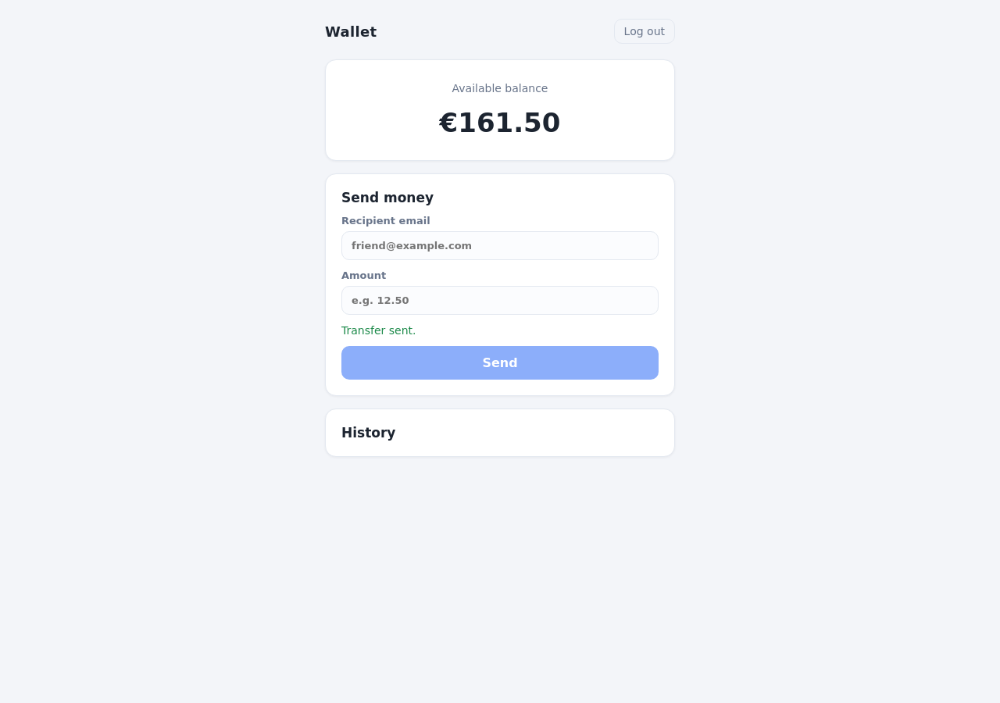
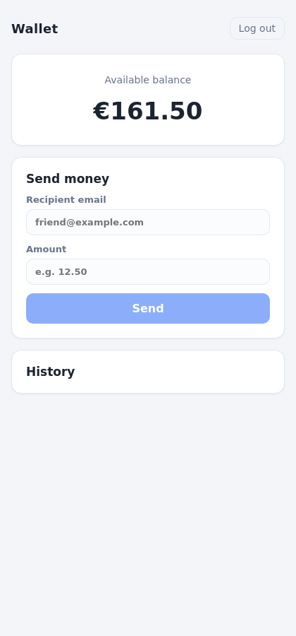
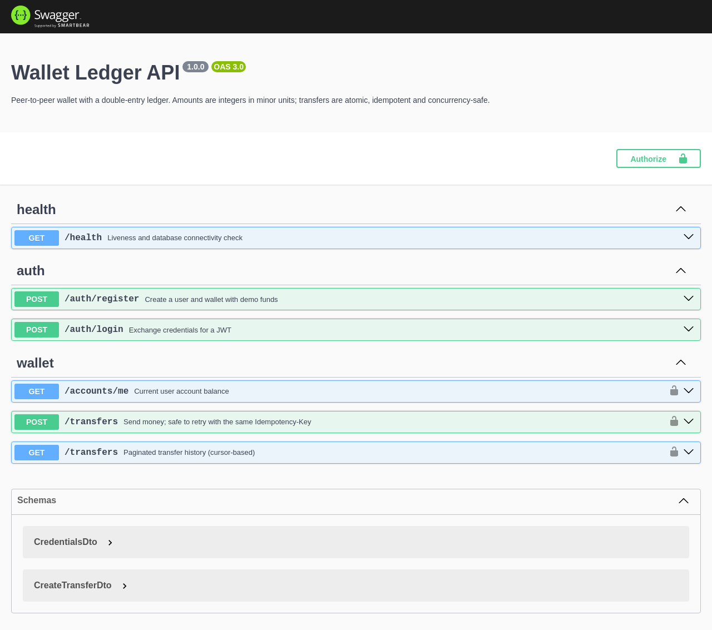

# Wallet Ledger

A peer-to-peer money wallet built to demonstrate **correctness under concurrency**, not pixel-perfect UI. Double-entry accounting, atomic transfers, idempotent retries, pessimistic row locking, cursor pagination, JWT auth, rate limiting, OpenAPI docs, migrations, and a full unit + E2E test suite in CI.


## Screens

| Register | Login | Wallet & history |
|---|---|---|
|  |  |  |

| Validation | Transfer success | Mobile | API docs |
|---|---|---|---|
|  |  |  |  |

## Architecture

```
┌─────────────┐   HTTPS + Bearer JWT    ┌──────────────────┐   SQL (pooled)   ┌────────────┐
│  React SPA  │ ──────────────────────► │     NestJS       │ ───────────────► │ PostgreSQL │
│ Vite · TS   │ ◄────────────────────── │ Throttle · Guard │                  │            │
└─────────────┘    JSON (minor units)   │ Swagger @ /docs  │                  └────────────┘
                                        └──────────────────┘
```

- `api/` — NestJS 10, TypeORM, PostgreSQL. Money lives here.
- `web/` — React 18 + Vite + TanStack Query. Thin client, no business rules.
- `docker-compose.yml` — local PostgreSQL.

### Domain model

```
User 1──1 Account (balanceCents, currency)
Account 1──* Transfer (from, to, amountCents, idempotencyKey)   UNIQUE (fromAccountId, idempotencyKey)
Transfer 1──2 LedgerEntry (debit −amount, credit +amount)        SUM(entries) = 0 invariant
```

## Invariants this system guarantees

| Guarantee | Mechanism | Covered by |
|---|---|---|
| No float rounding on money | Integer minor units end to end; DTOs reject non-integers | unit + e2e |
| No half-applied transfers | Debit, credit, transfer row and balance updates in one transaction | e2e |
| Auditability | Every transfer writes balanced double-entry rows | unit (`ledger.rules`) |
| Retries never pay twice | Client-generated `Idempotency-Key`; replay returns original transfer; unique constraint closes the race window | e2e incl. concurrent identical requests |
| No overdrafts under parallel load | `SELECT … FOR UPDATE` on both accounts, always locked in ascending-id order (deadlock-free) | e2e: 5 concurrent distinct transfers |
| Cursor-safe history | Keyset pagination (`?cursor=&limit=`), max 100/page | e2e |
| Abuse resistance | `@nestjs/throttler` global rate limit, bcrypt passwords, strict DTO whitelisting | e2e |

## Quick start

```bash
cp api/.env.example api/.env          # defaults work with docker compose
docker compose up -d
cd api  && npm ci && npm run migration:run && npm run start:dev   # :3001, docs at /docs
cd web  && npm ci && npm run dev                                  # :5173
```

Register two users (each starts with €100 demo funds) and send money between them.

```bash
cd api && npm test           # unit tests
cd api && npm run test:e2e   # e2e against a throwaway database
```

## API

Interactive spec: **`GET /docs`** (Swagger UI).

| Method | Route | Notes |
|---|---|---|
| POST | `/auth/register` | Creates user + account with demo funds. Returns `{ accessToken }` |
| POST | `/auth/login` | Returns `{ accessToken }` |
| GET | `/health` | Liveness + DB connectivity |
| GET | `/accounts/me` | 🔒 Balance in minor units |
| POST | `/transfers` | 🔒 Header `Idempotency-Key` required. Body `{ toEmail, amount }` |
| GET | `/transfers` | 🔒 Keyset-paginated history with `sent`/`received` direction |

```bash
TOKEN=$(curl -s -X POST localhost:3001/auth/login \
  -H 'Content-Type: application/json' \
  -d '{"email":"alice@demo.io","password":"password123"}' | jq -r .accessToken)

curl -X POST localhost:3001/transfers \
  -H "Authorization: Bearer $TOKEN" \
  -H "Idempotency-Key: $(uuidgen)" \
  -H "Content-Type: application/json" \
  -d '{"toEmail":"bob@demo.io","amount":1050}'
```

Sending the same request twice with the same key returns the original transfer and moves money exactly once.

## Configuration

| Variable | Default | Purpose |
|---|---|---|
| `NODE_ENV` | `development` | Disables schema sync and Swagger in production |
| `PORT` | `3001` | HTTP port |
| `DATABASE_URL` | local Postgres | Connection string |
| `DATABASE_SSL` | `false` | Set `true` for Neon/Supabase/RDS |
| `JWT_SECRET` | — | Required; fail-fast if missing (`getOrThrow`) |
| `WEB_ORIGIN` | `http://localhost:5173` | CORS allowlist, comma-separated |
| `THROTTLE_LIMIT` | `100` | Requests per TTL per client |
| `VITE_API_URL` | `http://localhost:3001` | API base URL for the SPA |

## Database migrations

Schema is owned by migrations (`npm run migration:run`), never by runtime sync in production. Generate new ones with `npm run migration:generate src/migrations/<Name>`.

## Testing strategy

- **Unit** — pure ledger rules (balanced entries, overdraft, self-transfer) without a DB.
- **E2E (10 specs)** — boots the real Nest app against a throwaway schema: health, auth guards, happy path, idempotent replay, **concurrent identical requests move money once**, **concurrent distinct transfers cannot overdraft**, strict DTO validation, cursor pagination.

## CI

GitHub Actions runs lint-free builds, unit tests and the E2E suite against a PostgreSQL service container on every push/PR (`.github/workflows/ci.yml`).

## Deployment

- **Web**: any static host (Vercel/Netlify) — `cd web && npm run build`, set `VITE_API_URL`.
- **API**: needs a long-running process or serverless adapter — Railway/Fly.io directly, or Vercel server functions behind a lambda wrapper. Provision hosted Postgres (Neon/Supabase), set `DATABASE_SSL=true`, run `migration:run` on release, set a strong `JWT_SECRET` and add the deployed web origin to `WEB_ORIGIN`.

## Trade-offs (deliberate)

- **Balance column + ledger**: reads are O(1); the ledger remains the reconciliation source of truth.
- **Pessimistic over optimistic locking**: for money, waiting on a short row lock beats retry storms on version conflicts. Consistent lock ordering makes deadlocks impossible.
- **`bigint` exposed as JS `Number`**: safe below 2^53 cents (~€90 trillion); a payment processor would use BigInt/decimal end to end.
- **Demo funds on registration**: keeps the demo self-serve; a real system would integrate a funding source and KYC boundaries.

## Stack

NestJS 10 · TypeORM · PostgreSQL 16 · JWT/passport · bcrypt · class-validator · @nestjs/throttler · Swagger/OpenAPI · Jest (unit + supertest e2e) · React 18 · Vite · TanStack Query · TypeScript · GitHub Actions
